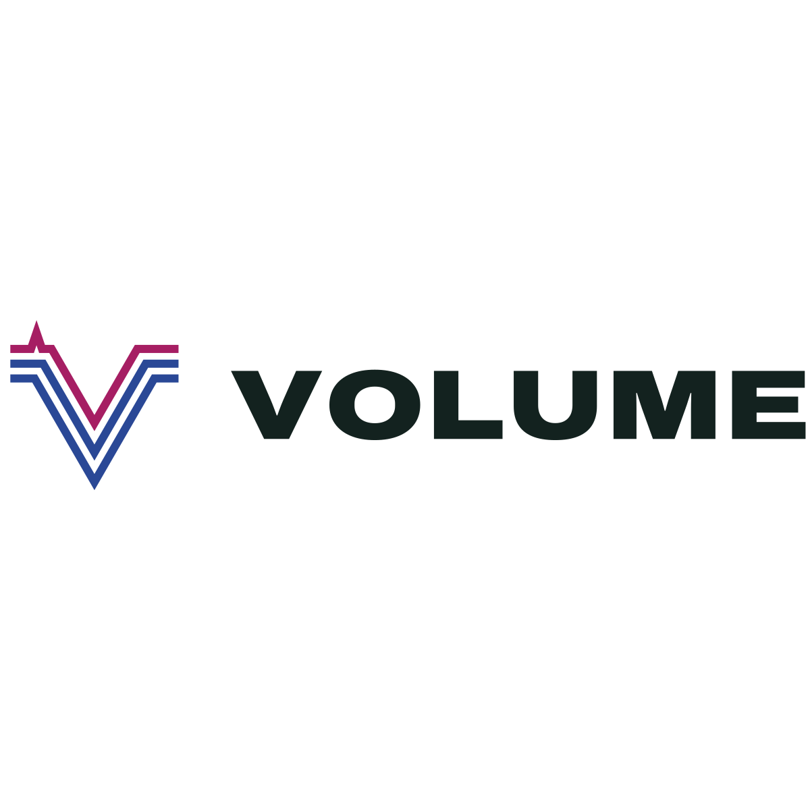

# healthwealth

iOS apps that turn Apple Health workout history into something worth looking at.

| Project | What it is |
| --- | --- |
| [**Volume**](Volume/) | The main app. A year of training as a heatmap, automatic PRs, muscle recovery, optional Hevy import, and Home and Lock Screen widgets. HealthKit with background sync. [Read more](Volume/README.md) |
| [**PRHeatmap**](PRHeatmap/) | An earlier prototype of the year heatmap and PR detection, running on sample data only |

[](Volume/)

## Quick start

```bash
cd Volume && xcodegen generate && open VolumeHeatmap.xcodeproj
```

To run on your own iPhone, set your team ID, bundle IDs and App Group in `Volume/project.yml`
first. The [Volume README](Volume/README.md#build-and-run) lists them.

Both projects need iOS 17+, Xcode 16+ and [XcodeGen](https://github.com/yonaskolb/XcodeGen). All
analysis runs on the device, and neither app uploads health data.
