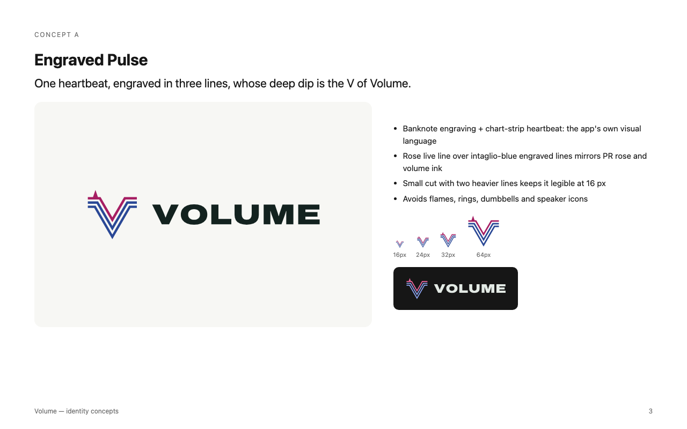

# Volume logo

**Engraved Pulse.** One heartbeat, engraved in three parallel lines, whose deep dip is the V of Volume.
The top line carries the heartbeat spike and is the *live* line (rose). The two engraved lines below are
intaglio blue: the same inks the app uses for PRs and for training volume.

## Files (`final/`)

| Use | File |
| --- | --- |
| Symbol, colour (light backgrounds) | `volume-symbol.svg` |
| Symbol, colour (dark backgrounds, thinned lines) | `volume-symbol-dark.svg` |
| Symbol, small sizes (16–47 px) | `volume-symbol-small.svg`, `volume-symbol-small-dark.svg` |
| Symbol, one colour | `volume-symbol-black.svg`, `volume-symbol-white.svg`, `volume-symbol-mono-2a4896.svg` |
| Horizontal lockup | `volume-horizontal.svg`, `volume-horizontal-dark.svg`, `-black`, `-white` (+ 1200 px PNGs) |
| Stacked lockup | `volume-stacked.svg`, `volume-stacked-dark.svg` |
| Wordmark only | `volume-wordmark.svg`, `volume-wordmark-dark.svg` |
| iOS app icon masters (1024, full bleed) | `volume-app-icon.svg`, `volume-app-icon-dark.svg` |
| Square avatar / social | `volume-symbol-square.svg` |
| Web: favicon.ico, PNG icons, manifest, `<head>` snippet | `web/` |

The app icon is already in the project at `App/Assets.xcassets/AppIcon.appiconset` (light and dark,
1024 px, opaque) and wired up through `ASSETCATALOG_COMPILER_APPICON_NAME` in `project.yml`.

All artwork is filled outlines: no live text, no strokes, no gradients. To change geometry, edit the numbers in
`source/build_logo.py` and run `python3 source/build_logo.py`; don't hand-edit the SVGs.

## Colour

| Role | Light | Dark | RGB (light) |
| --- | --- | --- | --- |
| Live line (rose) | `#A61E63` | `#F2689F` | 166 30 99 |
| Engraved lines (intaglio blue) | `#2A4896` | `#8EA6F2` | 42 72 150 |
| Wordmark (ink) | `#13221F` | `#E2E9E4` | 19 34 31 |
| Ground (paper) | `#EEF1EC` | `#0E1614` | 238 241 236 |

One-colour versions: black, white or intaglio blue. Never set the whole mark in rose: rose means "live / PR" in
the app. For print, convert from these values and proof them; no CMYK or Pantone matches have been specified yet.

## Clear space and minimum size

- **Unit x** = the distance between two engraved lines (20 of the symbol's 256 units).
- **Clear space**: at least **2x** on every side of the symbol or lockup. No other text or graphics inside it.
- **Full symbol**: 48 px / 12 mm and up.
- **Small cut** (two heavier lines): 16–47 px. Favicons, tab bars and the Lock Screen use this.
- **Horizontal lockup**: 120 px / 30 mm wide minimum. **Wordmark**: 80 px wide minimum.

## Lockups

- Horizontal: wordmark cap height = 36 % of the symbol height, gap = 56/256 of the symbol height.
- Stacked: symbol centred over the wordmark, gap = 40/256 of the symbol height.
- Wordmark: Archivo, weight 900, width 125 %, tracking +0.02 em, converted to outlines
  (`source/outline_wordmark.swift`). Archivo is licensed under the SIL Open Font License, which allows logo use.

## Don't

- Don't open up the spike again (an open spike reads as the letter A).
- Don't recolour the lines individually, add gradients, glows or shadows.
- Don't use the three-line symbol below 48 px; use the small cut.
- Don't put the light version on dark grounds; use the `-dark` files (their lines are thinned for irradiation).
- Don't rotate, stretch, outline or re-space the lines.
- Don't pair the mark with speaker or sound imagery: this Volume is training volume.

## Open items

- **Trademark**: not cleared. Run a professional search (USPTO, EUIPO, App Store names) before launch.
- **Tinted icon**: iOS 18's tinted (monochrome) app icon variant isn't made yet.
- **Pattern**: the engraved lines can extend into a background pattern for the share card and splash screen.

`volume-presentation.html` and `presentation/` hold the presentation board.
