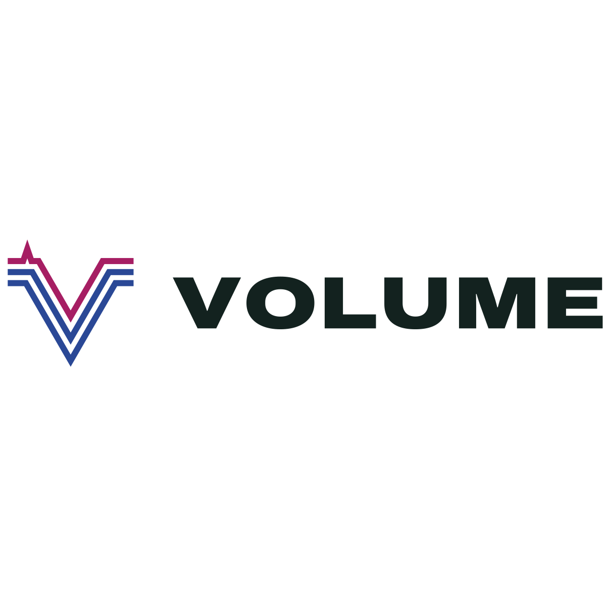

# Volume: workout volume and PR heatmap



An iOS 17+ app you never have to log anything in. It reads your workout history from Apple Health
and shows:

- a year of training as a heatmap, one cell per day;
- personal records, detected automatically;
- muscle-group recovery for the five groups below;
- the same at a glance in Home Screen and Lock Screen widgets.

All analysis runs on the device. Health data is never uploaded.

## Features

- **Year tab.** The day grid (GitHub style, 7 × 52–53) or a weekly skyline (one bar per week, with
  a dashed "typical week" line). Each cell is shaded 0–4 against your own trailing 90-day volume.
  Rose medal rings mark PR days. Tap a day to see its workouts.
- **Filters.** All, strength, running, cycling, or HIIT and other.
- **Automatic PRs.**
  - Running and cycling pace for 1K, 5K, 10K, half marathon and marathon.
  - Longest distance.
  - Calories per minute for sessions of 15 minutes or more.
  - Training load (TRIMP).
  - Lift PRs (estimated 1RM) once a Hevy export is imported.
- **Recovery tab.** Readiness for chest, back, shoulders, arms and legs. The tab shows the
  workouts behind each score and when the group will be ready again ("primed by Friday morning").
- **Hevy import (optional).** Import Hevy's "Export Workouts" CSV in Settings. Recovery then follows
  the muscles you actually trained, using sets, reps and weights, and lift PRs are added. The
  file stays on the iPhone.
- **Widgets.** Medium (16-week heatmap and weekly streak), large (20 weeks and all readiness
  bars) and Lock Screen rectangular (streak and most-fatigued group). The widgets project recovery
  forward hour by hour without the app running.
- **Share card.** A 4:5 "year card" image (1080 × 1350) to share.
- **Accessibility.** The heatmap can be shown as a list for VoiceOver and very large text.
  Dynamic Type works throughout, and Reduce Motion is respected.
- **Live sync.** A HealthKit observer query with background delivery, plus an anchored query, so
  new workouts appear without a manual refresh.

## Layout

| Path | What |
| --- | --- |
| `Packages/VolumeKit/Sources/VolumeCore` | Logic with no HealthKit dependency: heatmap levels, PR detection, recovery decay, streaks, Hevy CSV parsing and merge, widget snapshot, demo data |
| `Packages/VolumeKit/Sources/VolumeUI` | Shared SwiftUI: theme and bundled fonts, motion, heatmap cells, readiness bars, widget layouts |
| `App/` | The SwiftUI app: tabs, onboarding, settings, `HealthSyncService` (authorization, backfill, background delivery) and `WorkoutMapper` |
| `Widgets/` | WidgetKit extension |
| `Design/Logo/` | Logo source, final SVG/PNG files and web icons (see its README) |
| `project.yml` | XcodeGen spec (HealthKit, background delivery and App Group entitlements) |

## Build and run

You need Xcode 16+ and [XcodeGen](https://github.com/yonaskolb/XcodeGen).

```bash
xcodegen generate && open VolumeHeatmap.xcodeproj
```

Run the engine tests (31 Swift Testing tests, on macOS, with no simulator):

```bash
cd Packages/VolumeKit && swift test
```

**To run on your own iPhone,** change these values in `project.yml`, then run `xcodegen generate`
again:

- `DEVELOPMENT_TEAM`: your team ID.
- `bundleIdPrefix` and the two `PRODUCT_BUNDLE_IDENTIFIER`s.
- `APP_GROUP_ID`. The app and the widget read it from Info.plist.

### Debug launch arguments

| Argument | Effect |
| --- | --- |
| `-demoData` | A deterministic sample year, since the simulator has no workouts |
| `-widgetGallery` | Renders the widget layouts in the app at real widget sizes |
| `-onboarding` | Shows the first-run welcome again |
| `-widgetOffer` | Shows the "add the widget" card |
| `-importHevy <path>` | Imports a Hevy CSV at launch |
| `-demoLiveWorkout` | Simulates a workout arriving while the app is open |

## How the numbers are worked out

- **Heatmap levels.** Each day's score is the mean of `energy / p75(energy)` and
  `duration / p75(duration)` over the trailing 90 days. If there are fewer than 5 active days, it
  uses all history instead. The cut-offs are < 0.5, < 0.8, < 1.1 and ≥ 1.1. A day with a logged
  workout is never level 0.
- **PRs.** A PR needs an earlier best in the same activity and metric, so a fresh 365-day
  backfill doesn't flood the grid with them. Each run competes in the longest standard distance it
  covers: a 10.3 km run counts as a 10K effort. The minimum improvement is 0.1%.
- **TRIMP.** Edwards style, from duration × the heart-rate zone of the session's average heart
  rate. Max heart rate is estimated from your workouts.
- **Recovery.** `Readiness(t) = 100 × (1 − Σ Sᵢ · e^(−Δtᵢ/τ))` over a 96-hour window. τ is 24 h for
  arms, 28 h for shoulders, 30 h for chest, 32 h for back and 36 h for legs. Strain comes from the
  muscles a workout hit, taken from Hevy sets when available, otherwise from the workout type and
  title. That is scaled by session intensity (TRIMP, else calories, else duration). Readiness is
  76–100 ready, 45–75 recovering, under 45 rest.
- **Denied Health access.** HealthKit doesn't tell an app when read access was denied. A user who
  denied it sees the empty year with a "Check Health access" link.

## Not yet built

The watchOS app. On iPhone, the Lock Screen widget covers the at-a-glance case.
